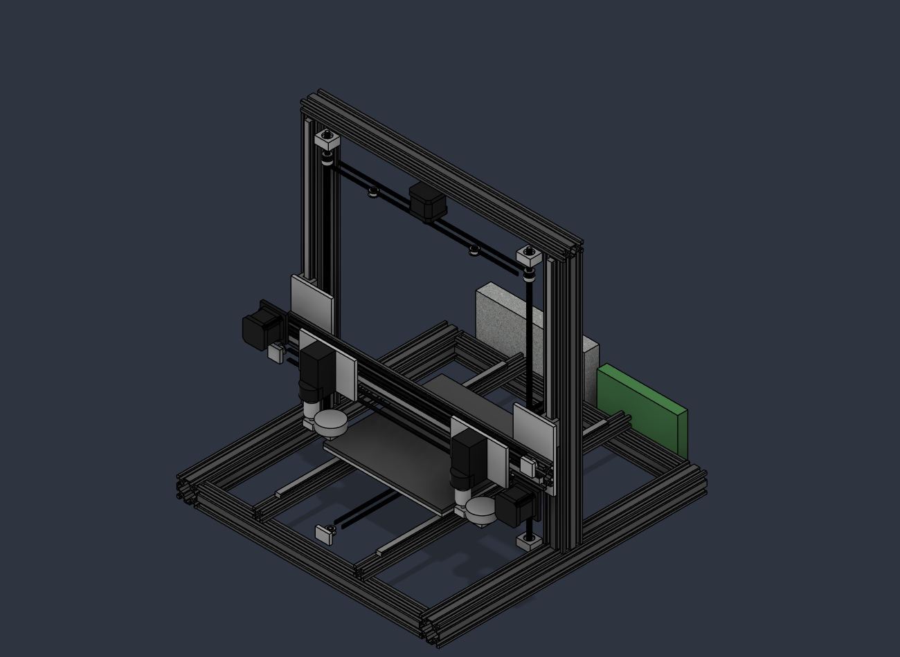
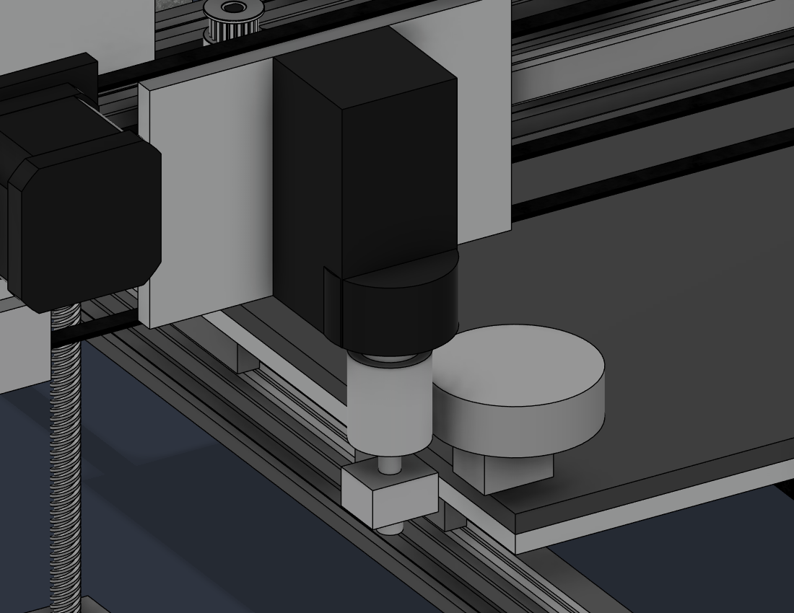

# IDEX 3D printer

A dual-extruder (IDEX) 3D printer built from V-slot aluminium extrusion, designed
around a parametric Fusion 360 model rather than a pile of guesses. This repo holds
the model exports, the engineering analysis, a priced bill of materials and the
Klipper configuration.

**Status: design complete, nothing built.** Every sub-assembly is modelled:
frame, X gantry, two toolheads, Y axis and bed, Z axis, electronics.

| | |
|---|---|
| Build volume | 230 × 235 × 230 mm |
| Kinematics | Cartesian, IDEX, moving bed (Y) |
| Frame | 4040 / 2040 / 2020 V-slot, 520 × 530 × 560 mm |
| Motion | MGN12H linear rail on every axis, GT2 6 mm belts |
| Z | One motor, belt-linked to two TR8×8 lead screws |
| Electronics | BTT Octopus Pro V1.1 + Raspberry Pi, 6 × TMC2209, 24 V |
| Toolhead mass | 518 g each (modelled) |
| Moving bed mass | 1.27 kg (modelled) |
| Frame mass | 4.48 kg; complete modelled machine **13.41 kg**, 87 bodies |
| Estimated cost | ~A$2,015 inc. GST |

## What's here

```
docs/
  build-spec.html    the full write-up: 15 sections, from "why it's slow" to the BOM
  design-notes.md    engineering findings, corrections, and what is still unverified
  bom.md             bill of materials with supplier links and AUD prices
  bom.json           BOM source: prices, and every cut length against its CAD part
  skeleton-plan.md   how the model was made skeleton-driven
cad/
  idex-printer-assembly.f3d    Fusion archive (open this one to edit)
  idex-printer-assembly.step   portable STEP export
  parameters.csv             all 47 parameters, with their expressions
  mass-report.csv            per-part mass
klipper/
  printer.cfg        full machine config for the Octopus Pro V1.1
  idex-macros.cfg    toolchange, copy and mirror modes, start/end
scripts/
  check_model.py     design-rule checks - run as a Fusion script
  skeleton_tie.py    ties parts to the Skeleton without moving them
  nothing_moved.py   compares every part with a saved baseline
  genbom.js          bom.json -> bom.md
```

## Checking the model

Run `scripts/check_model.py` as a Fusion script with the assembly open. It
asserts the design rules numerically instead of by eye: nozzle height against
`bed_top`, every bracket touching a frame member, lead screws seated, rails
centred on real V-slots, interference limited to the known shaft-through-bore
set, timeline health, toolhead parking, every part tied to the skeleton, every
parameter driving something, driver ranges, and a BOM check line that measures
every cut length in the model. **14 of 14 pass.** Set `FLEX_CASES` to re-run the
geometry rules with `build_x`, `build_y` or `upright_h` changed.





Open `docs/build-spec.html` in a browser — it is the readable version of everything
below.

## The design in one paragraph

The starting point was an existing dual-extruder design that modelled out at about
3,500 mm/s². The limiting part was not the frame and not the belts: it was the
**toolhead**, a 1.42 kg mass hanging off a single MGN12H carriage block. Replacing the
Titan extruders and Chimera hotend with Orbiter v2.5 direct drives and separate V6
hotends, and putting **two** carriage blocks under each toolhead, takes the moving mass
to 518 g. The X axis then models out around 13,200 mm/s² — at which point the **bed**
becomes the slowest axis — 5,948 mm/s² after the bed was rebuilt (see
[design-notes.md](docs/design-notes.md) §12), and that is what the Klipper config is set to.

## How parametric is it, really?

Every part is tied to a `Skeleton` component of construction planes driven by
the parameters - 91 of 91 - and the design rules are re-checked at other sizes:

| Change | Result |
|---|---|
| `build_x` 230 → 300 | frame, beam, rail, belts and toolhead B follow; all rules hold |
| `build_y` 235 → 305 | frame, bed, Y rails, belts, motor and electronics follow; all rules hold |
| `upright_h` 500 → 570 | uprights, Z rails and top tie follow; **the 500 mm lead screws no longer reach** - flagged |

A part that stays put is not a failure (the frame grows from its left, front and
floor); a broken rule is. See [design-notes.md](docs/design-notes.md) §20.

The vertical stack propagates too: `bed_top` is built from the
real layer thicknesses and `gantry_z = bed_top + th_drop`, so changing the bed
construction moves the gantry to match.

Two parameters are worth knowing about:

- **`x_beam_len = build_x + 2·carriage_w + 2·park_gap + 2·end_allow`** — on an IDEX the
  beam has to be long enough to park both toolheads clear of the build area. Making the
  carriages wider makes the whole machine wider.
- **`gantry_z = bed_top + th_drop`** — the gantry height is set by the toolhead, not
  chosen. Modelling the toolhead properly moved the beam 68 mm; before that, the nozzle
  sat inside the bed.

## Licence

MIT for the configuration and scripts. The CAD is published so others can build from
it; attribution is appreciated but not required.
